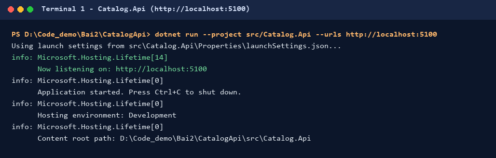
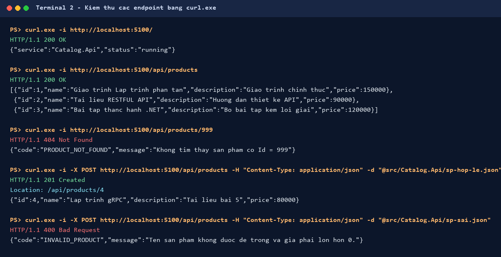
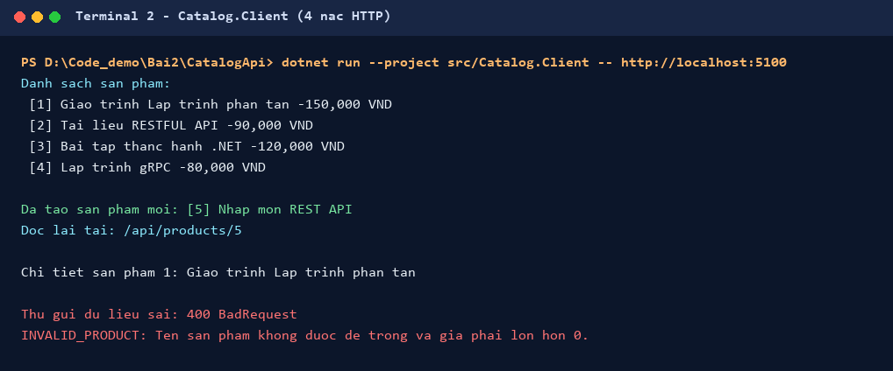
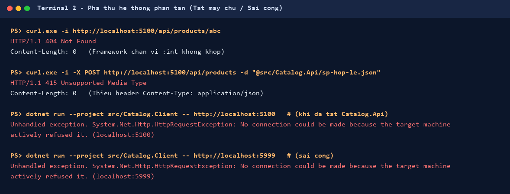

# Bài 2: Xây dựng hệ thống phân tán Client–Server (`CatalogApi`)

* **Sinh viên thực hiện:** Cấn Văn Thái
* **Mã sinh viên:** DTC245200867
* **Lớp:** CNTTK23C
* **Môn học:** Phát triển ứng dụng phân tán

---

## 1. Cấu trúc thư mục nộp bài

```text
Cấn Văn Thái - dtc245200867/Bai2/
├── README.md
├── images/
│   ├── 01-server-running.png
│   ├── 02-curl-endpoints.png
│   ├── 03-client-4-steps.png
│   └── 04-breaking-tests.png
└── CatalogApi/
    ├── .gitignore
    ├── BAO_CAO.md
    ├── CatalogApi.slnx
    ├── requests.http
    └── src/
        ├── Catalog.Api/       (Máy chủ ASP.NET Core Minimal API - cổng 5100)
        └── Catalog.Client/    (Máy khách Console dùng HttpClient)
```

---

## 2. Lệnh build và chạy hệ thống

Di chuyển vào thư mục `CatalogApi`:

```powershell
cd CatalogApi
dotnet build
```

### Terminal 1 — Chạy máy chủ (`Catalog.Api`)

```powershell
dotnet run --project src/Catalog.Api --urls http://localhost:5100
```

### Terminal 2 — Chạy máy khách (`Catalog.Client`)

```powershell
dotnet run --project src/Catalog.Client -- http://localhost:5100
```

### Kiểm thử nhanh các endpoint bằng `curl.exe` hoặc `requests.http`

```powershell
curl.exe -i http://localhost:5100/
curl.exe -i http://localhost:5100/api/products
curl.exe -i http://localhost:5100/api/products/1
curl.exe -i http://localhost:5100/api/products/999
curl.exe -i http://localhost:5100/api/products/abc
curl.exe -i -X POST http://localhost:5100/api/products -H "Content-Type: application/json" -d "@src/Catalog.Api/sp-hop-le.json"
curl.exe -i -X POST http://localhost:5100/api/products -H "Content-Type: application/json" -d "@src/Catalog.Api/sp-sai.json"
curl.exe -i -X POST http://localhost:5100/api/products -d "@src/Catalog.Api/sp-hop-le.json"
```

---

## 3. Ảnh kết quả chạy thực tế

### 3.1. Khởi động máy chủ `Catalog.Api` tại cổng `5100`



### 3.2. Kiểm thử các endpoint `GET` và `POST` bằng `curl.exe`



### 3.3. Chạy máy khách `Catalog.Client` đủ 4 nấc



### 3.4. Kết quả phá thử (sai kiểu tham số, thiếu header, tắt máy chủ, sai cổng)



---

## 4. Bảng phá thử

| STT | Ca thử | Mong đợi | Thực tế |
| :-: | :--- | :--- | :--- |
| 1 | `GET /api/products/999` (Id không tồn tại) | Trả về `404 Not Found` kèm JSON `ApiError` (`PRODUCT_NOT_FOUND`) | Đúng `404 Not Found` + `{"code":"PRODUCT_NOT_FOUND","message":"Khong tim thay san pham co Id = 999"}` (do handler trả về). |
| 2 | `GET /api/products/abc` (sai kiểu `:int` trên route) | Trả về `404 Not Found` với body rỗng (`Content-Length: 0`) | Đúng `404 Not Found`, `Content-Length: 0` (framework chặn trước khi vào handler). |
| 3 | `POST /api/products` với dữ liệu hợp lệ (`sp-hop-le.json`) | Trả về `201 Created`, có header `Location: /api/products/4` và JSON sản phẩm mới | Đúng `201 Created`, `Location: /api/products/4`, body có `id: 4`. |
| 4 | `POST /api/products` với giá âm / tên rỗng (`sp-sai.json`) | Trả về `400 Bad Request` kèm `ApiError` (`INVALID_PRODUCT`) | Đúng `400 Bad Request` + `{"code":"INVALID_PRODUCT","message":"Ten san pham khong duoc de trong va gia phai lon hon 0."}`. |
| 5 | `POST /api/products` thiếu header `Content-Type: application/json` | Trả về `415 Unsupported Media Type` | Đúng `415 Unsupported Media Type` (framework từ chối đọc body trước khi vào handler). |
| 6 | Chạy `Catalog.Client` lần 2 khi `Catalog.Api` vẫn đang bật | Danh sách ban đầu có thêm sản phẩm đã tạo ở lần 1, sản phẩm mới có `Id` tăng tiếp | Đúng: danh sách tăng từ 4 lên 5 sản phẩm, tạo mới `[6] Nhap mon REST API`, `Location: /api/products/6`. |
| 7 | Tắt `Catalog.Api` (`Ctrl + C`) rồi chạy `Catalog.Client` | Máy khách báo lỗi kết nối bị từ chối (`Connection refused` tại `localhost:5100`) | Đúng: văng `HttpRequestException: No connection could be made because the target machine actively refused it. (localhost:5100)`. |
| 8 | Khởi động lại `Catalog.Api` rồi gọi `GET /api/products` | Dữ liệu tạo trước đó trong RAM bị mất, quay về 3 sản phẩm mặc định | Đúng: danh sách chỉ còn 3 sản phẩm ban đầu (`Id = 1, 2, 3`). |
| 9 | Chạy `Catalog.Client` trỏ sang cổng sai (`http://localhost:5999`) | Máy khách báo lỗi kết nối bị từ chối tại cổng `5999` | Đúng: văng `HttpRequestException: No connection could be made because the target machine actively refused it. (localhost:5999)`. |

---

## 5. Trả lời 3 câu hỏi thảo luận

### Câu 1: Gọi hàm `LaySanPham(2)` không bao giờ bị `"Connection refused"`. Vì sao gọi `GET /api/products/2` thì có thể?
* Trong ứng dụng một khối (monolith), hàm `LaySanPham(2)` nằm trong **cùng một tiến trình và cùng không gian bộ nhớ** với nơi gọi, nên lời gọi hàm diễn ra trực tiếp trong RAM và chắc chắn tới đích.
* Trong hệ thống phân tán, `Catalog.Client` và `Catalog.Api` là **hai tiến trình độc lập** giao tiếp qua mạng (TCP/HTTP). Khi gọi `GET /api/products/2`, máy khách phải mở kết nối tới địa chỉ và cổng (`localhost:5100`) của máy chủ; nếu máy chủ chưa chạy, đã tắt, hoặc máy khách gọi nhầm cổng/địa chỉ thì hệ điều hành sẽ từ chối kết nối và gây ra lỗi `Connection refused`.

### Câu 2: Máy khách chạy 2 lần thấy dữ liệu khác nhau, dù code máy khách không đổi. Dữ liệu đó "sống" ở đâu?
* Dữ liệu đó **"sống" trong bộ nhớ RAM của tiến trình máy chủ (`Catalog.Api`)**, cụ thể là danh sách `products` (`List<ProductDto>`) tại máy chủ.
* Máy khách (`Catalog.Client`) không lưu trữ trạng thái dữ liệu của hệ thống mà chỉ gửi yêu cầu HTTP đọc/ghi lên máy chủ. Do đó, khi lần chạy 1 của máy khách gọi `POST /api/products` để thêm sản phẩm mới, trạng thái trên máy chủ thay đổi nên lần chạy 2 của máy khách thấy danh sách có thêm sản phẩm đó (và khi tiến trình máy chủ dừng thì dữ liệu trong RAM cũng mất).

### Câu 3: Nếu máy khách khai báo `record ProductDto(int Id, string Ten, ...)` thì chương trình có lỗi biên dịch không? Chạy ra gì?
* **Không có lỗi biên dịch**, vì `Catalog.Client` và `Catalog.Api` là hai project độc lập không dùng chung mã nguồn; trình biên dịch của `Catalog.Client` chỉ kiểm tra hợp lệ bên trong chính nó.
* **Khi chạy:** Chương trình vẫn chạy nhưng **không ánh xạ được giá trị tên sản phẩm** (thuộc tính `Ten` sẽ bị `null` hoặc chuỗi rỗng). Lý do là máy chủ trả về JSON với trường `"name"`, còn `System.Text.Json` ánh xạ theo **tên thuộc tính** (không phân biệt hoa/thường), nên `"name"` không khớp với `Ten` của máy khách — vi phạm hợp đồng JSON giữa hai bên.
